# Shimeji — Cross-Platform Desktop Mascot (Windows • Linux • macOS)

<p align="center">
  
</p>

<p align="center">
  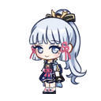
</p>

<p align="center">
  <a href="#-tiếng-việt">🇻🇳 <strong>Tiếng Việt</strong></a> &nbsp;|&nbsp; <a href="#-english">🇬🇧 <strong>English</strong></a> &nbsp;|&nbsp; <a href="#-danh-sách-toàn-bộ-400-nhân-vật--full-400-character-gallery">🎭 <strong>400+ Characters Gallery</strong></a>
</p>

---

# 🇻🇳 Tiếng Việt

**Shimeji** là ứng dụng thú cưng màn hình (Desktop Mascot / Pet) mã nguồn mở, hoạt động mượt mà trên cả 3 hệ điều hành **Windows 10/11**, **Linux** (Ubuntu, Debian, Arch...) và **macOS**. 

Phiên bản này được nâng cấp toàn diện với kho **hơn 400 nhân vật anime & game**, hệ thống **bong bóng thoại & lời nhắc sức khỏe** thông minh, cùng giao diện cài đặt (**Settings GUI**) trực quan hỗ trợ tìm kiếm và xem trước hình ảnh thời gian thực.

---

## ✨ Tính Năng Nổi Bật

- 🎭 **Kho 400+ Nhân Vật Đa Dạng**: Bao gồm Genshin Impact (Xiao Catboy, Ayaka...), Vocaloid (Hatsune Miku, Rin, Len...), Pokemon, Naruto, One Piece, Undertale, Marvel, v.v.
- 💬 **Hệ Thống Trò Chuyện & Bong Bóng Thoại**:
  - Bong bóng thoại hiển thị nổi trên đầu nhân vật, hỗ trợ tiếng Việt đầy đủ và tự động co giãn.
  - **Click chuột trái** vào nhân vật để trò chuyện ngay lập tức.
  - Thư viện câu thoại phong phú, dễ dàng tự thêm câu thoại yêu thích.
- ⏰ **Hệ Thống Lời Nhắc Sức Khỏe Thông Minh**:
  - Nhắc nhở định kỳ: uống nước, nghỉ mắt ngơi sau thời gian dài nhìn màn hình, vận động nhẹ, ăn đúng giờ.
  - Hỗ trợ chuông báo (beep) và thông báo desktop (Desktop Notification).
  - Click chuột phải chọn **⏰ Lời nhắc tiếp theo** để xem lịch nhắc sắp tới.
- 🖥️ **Giao Diện Cài Đặt Hiện Đại (Settings GUI)**:
  - **Live Search**: Tìm kiếm và lọc tên nhân vật tức thì.
  - **Image Preview**: Xem trước hình ảnh nhân vật trực tiếp trước khi áp dụng.
  - **Thao tác nhanh**: Nút *Thả NV này* (`Spawn Selected`), *Thả TẤT CẢ* (`Spawn ALL`), *Tắt TẤT CẢ* (`Kill All Mascots`).
  - Tùy chỉnh thông số bám cửa sổ (`window.conf`), lọc tiêu đề cửa sổ (`titles.conf`) và bật/tắt tự nhân bản (Self-cloning).
- ⚙️ **Tương Thích Đa Nền Tảng & Màn Hình Độ Phân Giải Cao (High-DPI)**:
  - **Windows**: Hỗ trợ launcher độc lập `.exe` (`Shimeji.exe`, `ShimejiSettings.exe`), fix triệt để lỗi rơi xuyên sàn và lỗi màn hình phóng to (125%, 150%, 200%).
  - **Linux**: Bộ script cài đặt tự động 1 lệnh, tích hợp icon menu ứng dụng và phím tắt toàn cục.
  - **macOS**: Hỗ trợ cả chip Intel và Apple Silicon (M1/M2/M3/M4) qua AWT/Swing fallback.
  - Hỗ trợ các bản Java mới nhất: **Java 8, 11, 17, 21+** (với các cờ `--add-opens` tối ưu).

---

## 🎭 Một Số Nhân Vật Tiêu Biểu

<table>
  <tr>
    <td align="center"><strong>Ayaka (Genshin)</strong></td>
    <td align="center"><strong>Hatsune Miku</strong></td>
    <td align="center"><strong>Xiao Catboy (Genshin)</strong></td>
  </tr>
  <tr>
    <td align="center"></td>
    <td align="center"></td>
    <td align="center"></td>
  </tr>
</table>

*(Cùng hơn 400 nhân vật khác có sẵn trong thư mục `characters/`)*

---

## 📋 Yêu Cầu Hệ Thống

1. **Java**: Phiên bản Java 8 trở lên (Khuyến nghị **OpenJDK 17** hoặc **21**).
2. **Python**: Python 3.x kèm module `tkinter` (để chạy giao diện cài đặt `shimeji_settings.py`).

---

## 🚀 Hướng Dẫn Cài Đặt & Chạy Theo Hệ Điều Hành

### 🪟 1. Trên Windows (10/11)

#### Cách 1: Chạy trực tiếp (Nhanh nhất)
1. Tải bản release mới nhất hoặc clone repository này về máy.
2. Cài đặt **Java** (nếu máy chưa có Java, tải tại [Adoptium Temurin](https://adoptium.net/)).
3. **Khởi động Shimeji**:
   - Double-click vào file **`Shimeji.exe`** (chạy ẩn ngầm không hiện cửa sổ đen) hoặc **`launch.bat`**.
4. **Mở Cài Đặt & Đổi Nhân Vật**:
   - Double-click vào file **`ShimejiSettings.exe`** hoặc **`run-settings.bat`**.

---

### 🐧 2. Trên Linux (Ubuntu / Debian / Fedora / Arch)

#### Cài đặt các gói phụ thuộc:
```bash
# Ubuntu / Debian / Linux Mint:
sudo apt update
sudo apt install -y openjdk-17-jre python3 python3-tk

# Arch Linux:
sudo pacman -S jre17-openjdk python tk

# Fedora:
sudo dnf install java-17-openjdk python3 python3-tkinter
```

#### Cài đặt ứng dụng vào hệ thống (1 Lệnh duy nhất):
Chạy script cài đặt để tự động tích hợp Shimeji vào hệ thống:
```bash
./install-app.sh
```
Script này sẽ tự động:
- Cấp quyền thực thi cho các file script.
- Tạo lệnh chạy toàn cục trong Terminal: `shimeji` và `shimeji-settings`.
- Tạo biểu tượng ứng dụng trong **Menu Ứng Dụng (Application Launcher)** và ngoài **Desktop**.

#### Chạy thủ công không cần cài đặt:
```bash
# Khởi động mascot:
./launch.sh

# Mở giao diện cài đặt & đổi nhân vật:
./run-settings.sh
```

#### Gỡ cài đặt:
```bash
./uninstall-app.sh
```

> **Lưu ý với Wayland**: Mascot Shimeji tương tác tốt nhất trên giao diện **X11 / XOrg**. Nếu đang dùng Wayland (mặc định trên một số bản Ubuntu mới), bạn có thể chọn phiên bản *"Ubuntu on Xorg"* ở màn hình đăng nhập để mascot có thể nhảy bám lên các mép cửa sổ ứng dụng khác.

---

### 🍎 3. Trên macOS (Intel & Apple Silicon M1/M2/M3/M4)

#### Cài đặt các gói phụ thuộc qua Homebrew:
```bash
brew install openjdk@17 python-tk
```

#### Cấp quyền và khởi chạy:
1. Mở Terminal và điều hướng vào thư mục dự án:
   ```bash
   cd /path/to/shimeji
   chmod +x launch.sh run-settings.sh
   ```
2. **Khởi động Shimeji**:
   ```bash
   ./launch.sh
   ```
3. **Mở giao diện Cài Đặt**:
   ```bash
   ./run-settings.sh
   ```

> **Lưu ý trên macOS**: Trong lần đầu chạy, macOS có thể yêu cầu cấp quyền **Trợ năng (Accessibility)** và **Ghi màn hình (Screen Recording)** cho Terminal/Java trong *Cài đặt hệ thống > Quyền riêng tư & Bảo mật* để hiển thị cửa sổ trong suốt bám màn hình.

---

## 🎮 Hướng Dẫn Sử Dụng & Tương Tác

### Thao Tác Chuột Trực Tiếp Lên Nhân Vật:
- **Click chuột trái (1 lần)**: Nhân vật sẽ nói chuyện ngay lập tức (hiển thị câu thoại ngẫu nhiên qua bong bóng thoại).
- **Nhấn giữ chuột trái & Kéo**: Nhấc bổng và ném nhân vật bay lượn khắp màn hình!
- **Click chuột phải**: Mở menu thao tác:
  - `💬 Trò chuyện (Nói chuyện)`: Kích hoạt nói ngẫu nhiên.
  - `⏰ Lời nhắc tiếp theo`: Xem nội dung và thời gian còn lại của lời nhắc sắp tới.
  - `Quit / Dismiss`: Tắt riêng nhân vật này.
  - `Restore Window`: Khôi phục lại cửa sổ nếu nhân vật ném mất.

### Menu Biểu Tượng Khay Hệ Thống (System Tray):
Click chuột phải vào icon Shimeji ở góc thanh tác vụ (Taskbar) để:
- **Thêm nhân vật**: Tăng thêm mascot cùng loại trên màn hình.
- **Gom tụ nhân vật**: Gọi tất cả mascot tập trung về vị trí con trỏ chuột.
- **Giữ lại 1 nhân vật**: Giải tán tất cả mascot, chỉ giữ lại một bé duy nhất.
- **Mở Cài Đặt**: Khởi chạy nhanh cửa sổ Settings GUI.
- **Mở file cấu hình**: Mở nhanh `reminders.properties` và `dialogues.conf`.
- **Thoát**: Tắt hoàn toàn ứng dụng.

---

## ⚙️ Cấu Hình Nâng Cao

### 1. Cấu hình Lời Nhắc Sức Khỏe (`conf/reminders.properties`)
File này lưu các thiết lập nhắc nhở tự động:
- `reminders.enabled=true`: Bật/tắt toàn bộ lời nhắc.
- `reminders.sound.enabled=true`: Bật âm thanh beep khi có lời nhắc.
- `water.enabled=true` & `water.interval.minutes=45`: Nhắc uống nước sau mỗi 45 phút.
- `rest.enabled=true` & `rest.interval.minutes=60`: Nhắc nghỉ ngơi sau mỗi 60 phút.
- `fixed.time.X`: Đặt lịch nhắc cố định theo giờ trong ngày (ví dụ: `12:00` ăn trưa, `18:00` tan làm).

### 2. Tùy Chỉnh Câu Thoại (`conf/dialogues.conf`)
Mỗi dòng là một câu thoại ngẫu nhiên của mascot khi người dùng click vào bé. Bạn có thể tự do chỉnh sửa, thêm các câu thoại hài hước, động viên hoặc ghi nhớ công việc của riêng mình!

---

## 🎨 Hướng Dẫn Thêm Nhân Vật Mới (Custom Characters)

Để thêm nhân vật yêu thích của riêng bạn vào Shimeji:
1. Tạo một thư mục mới tại: `characters/TÊN_NHÂN_VẬT/`.
2. Đặt bộ ảnh sprite gồm 46 file ảnh định dạng PNG từ `shime1.png` đến `shime46.png` vào thư mục vừa tạo.
3. Mở **Settings GUI** (`./run-settings.sh` hoặc `ShimejiSettings.exe`).
4. Tìm tên nhân vật bạn vừa thêm từ danh sách, bấm **Áp dụng NV** hoặc **Thả NV này** để trải nghiệm ngay!

---

## 🛠️ Biên Dịch Từ Mã Nguồn (Build from Source)

### Trên Linux / macOS:
Yêu cầu đã cài đặt `ant` (`sudo apt install ant` hoặc `brew install ant`):
```bash
ant clean jar
```
File thực thi `Shimeji.jar` sẽ được đóng gói sẵn sàng trong thư mục gốc.

### Trên Windows:
Chạy trực tiếp file `build.bat` trong Command Prompt hoặc PowerShell (tự động biên dịch mã nguồn Java và C#):
```cmd
build.bat
```

---
---

# 🇬🇧 English

**Shimeji** is an open-source desktop mascot/pet application designed to run smoothly on **Windows 10/11**, **Linux** (Ubuntu, Debian, Fedora, Arch...), and **macOS**.

This edition features an extensive collection of **400+ anime & game characters**, an intelligent **speech bubble & health reminder system**, and a modern **cross-platform Settings GUI** with real-time search and live sprite previews.

---

## ✨ Features

- 🎭 **400+ Characters Library**: Genshin Impact, Vocaloid, Pokemon, Naruto, One Piece, Undertale, Marvel, and hundreds more.
- 💬 **Interactive Speech & Speech Bubbles**:
  - Smooth rounded speech bubbles over mascot heads with full text auto-wrapping.
  - **Left-click** on any mascot to chat instantly with randomized witty dialogues.
- ⏰ **Health & Productivity Reminders**:
  - Timed periodic reminders: drink water, eye rest breaks, stretching, meal times.
  - Optional sound alerts (beeps) and desktop notifications.
  - Right-click menu option **⏰ Next Reminder** to check pending alerts.
- 🖥️ **Modern Cross-Platform Settings GUI**:
  - **Live Search**: Instant filtering through 400+ characters.
  - **Live Sprite Preview**: Instant visual preview (`shime1.png`) before applying.
  - **Quick Controls**: *Spawn Selected*, *Spawn ALL*, *Kill All Mascots*.
  - Full configuration for window offsets (`window.conf`), window title filtering (`titles.conf`), and self-cloning toggles.
- ⚙️ **Cross-Platform & High-DPI Display Support**:
  - **Windows**: Native executables (`Shimeji.exe`, `ShimejiSettings.exe`), JNA Windows API integration, and fixed infinite falling bugs on scaled displays (125%, 150%, 200%).
  - **Linux**: One-command automated installer (`install-app.sh`), application menu shortcuts, and global terminal wrappers.
  - **macOS**: Native AWT/Swing compatibility across both Intel and Apple Silicon (M1/M2/M3/M4) chips.
  - Modern Java support: Fully compatible with **Java 8, 11, 17, and 21+**.

---

## 📋 Requirements

1. **Java**: JRE/JDK 8 or higher (Recommended: **OpenJDK 17** or **21**).
2. **Python**: Python 3.x with `tkinter` (for the Settings GUI).

---

## 🚀 Quick Start Guide by Operating System

### 🪟 1. Windows (10/11)

1. Download or clone this repository.
2. Ensure **Java** is installed ([Adoptium Temurin](https://adoptium.net/)).
3. **Run Mascot**:
   - Double-click **`Shimeji.exe`** (runs cleanly in background) or **`launch.bat`**.
4. **Open Settings**:
   - Double-click **`ShimejiSettings.exe`** or **`run-settings.bat`**.

---

### 🐧 2. Linux (Ubuntu / Debian / Fedora / Arch)

#### Install prerequisites:
```bash
# Ubuntu / Debian / Linux Mint:
sudo apt update
sudo apt install -y openjdk-17-jre python3 python3-tk

# Arch Linux:
sudo pacman -S jre17-openjdk python tk

# Fedora:
sudo dnf install java-17-openjdk python3 python3-tkinter
```

#### One-command system installation:
```bash
./install-app.sh
```
This script will automatically:
- Set execution permissions.
- Create global terminal commands: `shimeji` and `shimeji-settings`.
- Add desktop entries to your **Application Menu** and **Desktop**.

#### Run manually without installing:
```bash
./launch.sh
./run-settings.sh
```

#### Uninstall:
```bash
./uninstall-app.sh
```

---

### 🍎 3. macOS (Intel & Apple Silicon)

#### Install prerequisites via Homebrew:
```bash
brew install openjdk@17 python-tk
```

#### Launching:
```bash
cd /path/to/shimeji
chmod +x launch.sh run-settings.sh

# Start mascot:
./launch.sh

# Open settings:
./run-settings.sh
```

---

## 🎮 Mascot Controls & Interactions

- **Left-Click (1x)**: Mascot speaks a random dialogue in a speech bubble.
- **Left-Click & Drag**: Pick up and toss the mascot across your screen.
- **Right-Click**: Context menu (Quit, Next Reminder, Talk, Clone, Gather).
- **System Tray Icon**: Add mascots, gather mascots, keep only one, or open configurations.

---

## ⚙️ Configuration Files

- `conf/reminders.properties`: Configure hydration, rest intervals, sound alerts, and scheduled reminder times.
- `conf/dialogues.conf`: List of randomized speech lines shown when clicking on mascots.
- `window.conf`: Custom window offset adjustments.
- `titles.conf`: Target window title filter (leave blank to interact with all active windows).
- `settings.properties`: Mascot behavior settings (e.g., `selfCloningEnabled=true|false`).

---

## 🎨 Adding Custom Characters

1. Create a folder: `characters/YOUR_CHARACTER_NAME/`.
2. Add sprites `shime1.png` through `shime46.png` inside the folder.
3. Open Settings GUI (`./run-settings.sh` or `ShimejiSettings.exe`).
4. Select your character from the list and click **Apply Character** or **Spawn Selected**.

---

## 🛠️ Building from Source

- **Linux / macOS**:
  ```bash
  ant clean jar
  ```
- **Windows**:
  ```cmd
  build.bat
  ```

---


---

## 🎭 Danh Sách Toàn Bộ 400+ Nhân Vật / Full 400+ Character Gallery

Dưới đây là bộ sưu tập đầy đủ hơn **400 nhân vật** có sẵn trong dự án. Bạn có thể chọn bất kỳ nhân vật nào thông qua giao diện **Settings GUI** ( / ):

<table>
  <tr>
    <td align="center" width="16%">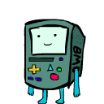<br/><sub><b>Adventure Time Beemo</b></sub></td>
    <td align="center" width="16%">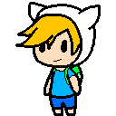<br/><sub><b>Adventure Time Finn</b></sub></td>
    <td align="center" width="16%">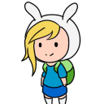<br/><sub><b>Adventure Time Fionna</b></sub></td>
    <td align="center" width="16%"><br/><sub><b>Adventure Time Jake</b></sub></td>
    <td align="center" width="16%">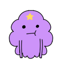<br/><sub><b>Adventure Time Lumpy Space Princess</b></sub></td>
    <td align="center" width="16%"><br/><sub><b>Adventure Time Marceline</b></sub></td>
  </tr>
  <tr>
    <td align="center" width="16%">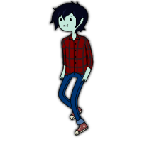<br/><sub><b>Adventure Time Marshall Lee</b></sub></td>
    <td align="center" width="16%">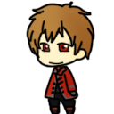<br/><sub><b>Alice In The Country Of Hearts Ace</b></sub></td>
    <td align="center" width="16%">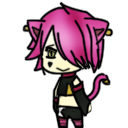<br/><sub><b>Alice In The Country Of Hearts Boris</b></sub></td>
    <td align="center" width="16%">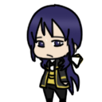<br/><sub><b>Alice In The Country Of Hearts Julius</b></sub></td>
    <td align="center" width="16%">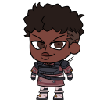<br/><sub><b>Apex Legends Bangalore</b></sub></td>
    <td align="center" width="16%">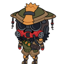<br/><sub><b>Apex Legends Bloodhound</b></sub></td>
  </tr>
  <tr>
    <td align="center" width="16%">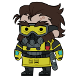<br/><sub><b>Apex Legends Caustic</b></sub></td>
    <td align="center" width="16%">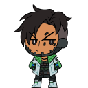<br/><sub><b>Apex Legends Crypto</b></sub></td>
    <td align="center" width="16%">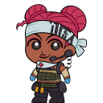<br/><sub><b>Apex Legends Lifeline</b></sub></td>
    <td align="center" width="16%">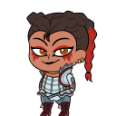<br/><sub><b>Apex Legends Loba</b></sub></td>
    <td align="center" width="16%">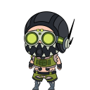<br/><sub><b>Apex Legends Octane</b></sub></td>
    <td align="center" width="16%">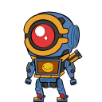<br/><sub><b>Apex Legends Pathfinder</b></sub></td>
  </tr>
  <tr>
    <td align="center" width="16%">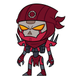<br/><sub><b>Apex Legends Revenant</b></sub></td>
    <td align="center" width="16%">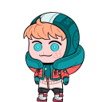<br/><sub><b>Apex Legends Wattson</b></sub></td>
    <td align="center" width="16%">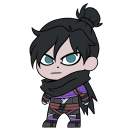<br/><sub><b>Apex Legends Wraith</b></sub></td>
    <td align="center" width="16%">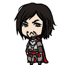<br/><sub><b>Assassins Creed Cesare</b></sub></td>
    <td align="center" width="16%">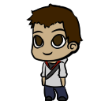<br/><sub><b>Assassins Creed Desmond</b></sub></td>
    <td align="center" width="16%">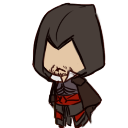<br/><sub><b>Assassins Creed Ezio</b></sub></td>
  </tr>
  <tr>
    <td align="center" width="16%">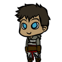<br/><sub><b>Assassins Creed Kadar</b></sub></td>
    <td align="center" width="16%">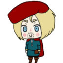<br/><sub><b>Assassins Creed Leonardo Da Vinci</b></sub></td>
    <td align="center" width="16%">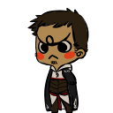<br/><sub><b>Assassins Creed Malik</b></sub></td>
    <td align="center" width="16%">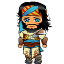<br/><sub><b>Assassins Creed Yusuf</b></sub></td>
    <td align="center" width="16%">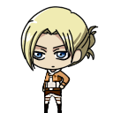<br/><sub><b>Attack On Titan Annie Leonhardt</b></sub></td>
    <td align="center" width="16%">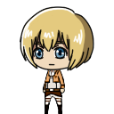<br/><sub><b>Attack On Titan Armin Arlert</b></sub></td>
  </tr>
  <tr>
    <td align="center" width="16%">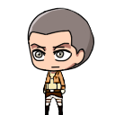<br/><sub><b>Attack On Titan Connie Springer</b></sub></td>
    <td align="center" width="16%">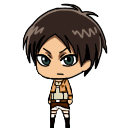<br/><sub><b>Attack On Titan Eren Jaeger</b></sub></td>
    <td align="center" width="16%">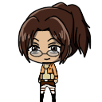<br/><sub><b>Attack On Titan Hanji Zoe</b></sub></td>
    <td align="center" width="16%">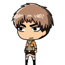<br/><sub><b>Attack On Titan Jean Kirschtein</b></sub></td>
    <td align="center" width="16%">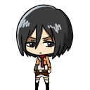<br/><sub><b>Attack On Titan Mikasa Ackerman</b></sub></td>
    <td align="center" width="16%">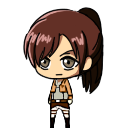<br/><sub><b>Attack On Titan Sasha Braus</b></sub></td>
  </tr>
  <tr>
    <td align="center" width="16%">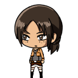<br/><sub><b>Attack On Titan Ymir</b></sub></td>
    <td align="center" width="16%"><br/><sub><b>Ayaka</b></sub></td>
    <td align="center" width="16%">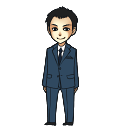<br/><sub><b>Bbc Sherlock Jim Moriarty</b></sub></td>
    <td align="center" width="16%">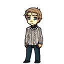<br/><sub><b>Bbc Sherlock John Watson</b></sub></td>
    <td align="center" width="16%">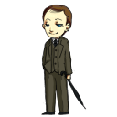<br/><sub><b>Bbc Sherlock Mycroft</b></sub></td>
    <td align="center" width="16%">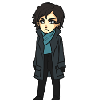<br/><sub><b>Bbc Sherlock Sherlock</b></sub></td>
  </tr>
  <tr>
    <td align="center" width="16%"><br/><sub><b>Bendy And The Ink Machine Bendy</b></sub></td>
    <td align="center" width="16%">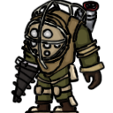<br/><sub><b>Bioshock Big Daddy</b></sub></td>
    <td align="center" width="16%"><br/><sub><b>Bioshock Fontaine</b></sub></td>
    <td align="center" width="16%">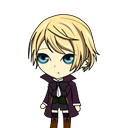<br/><sub><b>Black Butler Alois Trancy</b></sub></td>
    <td align="center" width="16%">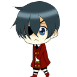<br/><sub><b>Black Butler Ciel Phantomhive</b></sub></td>
    <td align="center" width="16%">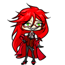<br/><sub><b>Black Butler Grell</b></sub></td>
  </tr>
  <tr>
    <td align="center" width="16%">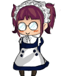<br/><sub><b>Black Butler Maylene</b></sub></td>
    <td align="center" width="16%">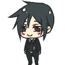<br/><sub><b>Black Butler Sebastian Michaelis</b></sub></td>
    <td align="center" width="16%">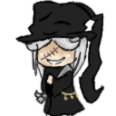<br/><sub><b>Black Butler Undertaker</b></sub></td>
    <td align="center" width="16%"><br/><sub><b>Black Butler William</b></sub></td>
    <td align="center" width="16%">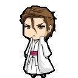<br/><sub><b>Bleach Aizen</b></sub></td>
    <td align="center" width="16%">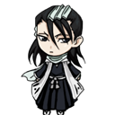<br/><sub><b>Bleach Byakuya Kuchiki</b></sub></td>
  </tr>
  <tr>
    <td align="center" width="16%">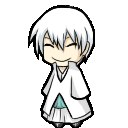<br/><sub><b>Bleach Gin Ichimaru</b></sub></td>
    <td align="center" width="16%"><br/><sub><b>Bleach Grimmjow</b></sub></td>
    <td align="center" width="16%"><br/><sub><b>Bleach Hisagi Shuuhei</b></sub></td>
    <td align="center" width="16%"><br/><sub><b>Bleach Ichigo</b></sub></td>
    <td align="center" width="16%"><br/><sub><b>Bleach Inoue Orihime</b></sub></td>
    <td align="center" width="16%"><br/><sub><b>Bleach Jushiro Ukitake</b></sub></td>
  </tr>
  <tr>
    <td align="center" width="16%"><br/><sub><b>Bleach Renji Abarai</b></sub></td>
    <td align="center" width="16%"><br/><sub><b>Bleach Rukia</b></sub></td>
    <td align="center" width="16%"><br/><sub><b>Bleach Shirosaki Hichigo</b></sub></td>
    <td align="center" width="16%"><br/><sub><b>Bleach Starrk</b></sub></td>
    <td align="center" width="16%"><br/><sub><b>Bleach Szayel Aporro</b></sub></td>
    <td align="center" width="16%"><br/><sub><b>Bleach Ulquiorra</b></sub></td>
  </tr>
  <tr>
    <td align="center" width="16%"><br/><sub><b>Bleach Uryuu Ishida</b></sub></td>
    <td align="center" width="16%"><br/><sub><b>Blobs Blob</b></sub></td>
    <td align="center" width="16%"><br/><sub><b>Bts Bangtan Boys J Hope Hobi Hyyh</b></sub></td>
    <td align="center" width="16%"><br/><sub><b>Bts Bangtan Boys J Hope Hobi Summer</b></sub></td>
    <td align="center" width="16%"><br/><sub><b>Bts Bangtan Boys Jimin</b></sub></td>
    <td align="center" width="16%"><br/><sub><b>Bts Bangtan Boys Jin</b></sub></td>
  </tr>
  <tr>
    <td align="center" width="16%"><br/><sub><b>Bts Bangtan Boys Jungkook Kookie Baby</b></sub></td>
    <td align="center" width="16%"><br/><sub><b>Bts Bangtan Boys Suga</b></sub></td>
    <td align="center" width="16%"><br/><sub><b>Bts Bangtan Boys V Tae Tae Not Today</b></sub></td>
    <td align="center" width="16%"><br/><sub><b>Bts Bangtan Boys V Tae Tae Puppy</b></sub></td>
    <td align="center" width="16%"><br/><sub><b>Creepypasta Ben Drowned</b></sub></td>
    <td align="center" width="16%"><br/><sub><b>Creepypasta Eyeless Jack</b></sub></td>
  </tr>
  <tr>
    <td align="center" width="16%"><br/><sub><b>Creepypasta Hoody</b></sub></td>
    <td align="center" width="16%"><br/><sub><b>Creepypasta Jeff The Killer</b></sub></td>
    <td align="center" width="16%"><br/><sub><b>Creepypasta Kagekao</b></sub></td>
    <td align="center" width="16%"><br/><sub><b>Creepypasta Laughing Jack</b></sub></td>
    <td align="center" width="16%"><br/><sub><b>Creepypasta Lost Silver</b></sub></td>
    <td align="center" width="16%"><br/><sub><b>Creepypasta Masky</b></sub></td>
  </tr>
  <tr>
    <td align="center" width="16%"><br/><sub><b>Creepypasta Rake</b></sub></td>
    <td align="center" width="16%"><br/><sub><b>Creepypasta Ticci Toby</b></sub></td>
    <td align="center" width="16%"><br/><sub><b>Creepypasta Zehnder</b></sub></td>
    <td align="center" width="16%"><br/><sub><b>Danganronpa Kokichi Oma</b></sub></td>
    <td align="center" width="16%"><br/><sub><b>Deathnote Beyond Birthday</b></sub></td>
    <td align="center" width="16%"><br/><sub><b>Deathnote Matt</b></sub></td>
  </tr>
  <tr>
    <td align="center" width="16%"><br/><sub><b>Digimon Agumon</b></sub></td>
    <td align="center" width="16%"><br/><sub><b>Digimon Culumon</b></sub></td>
    <td align="center" width="16%"><br/><sub><b>Digimon Gatomon</b></sub></td>
    <td align="center" width="16%"><br/><sub><b>Digimon Patamon</b></sub></td>
    <td align="center" width="16%"><br/><sub><b>Digimon Tanemon</b></sub></td>
    <td align="center" width="16%"><br/><sub><b>Digimon Terriemon</b></sub></td>
  </tr>
  <tr>
    <td align="center" width="16%"><br/><sub><b>Disney Movies Ariel And Meg</b></sub></td>
    <td align="center" width="16%"><br/><sub><b>Disney Movies Clopin Trouillefou</b></sub></td>
    <td align="center" width="16%"><br/><sub><b>Disney Movies Flynn Rider</b></sub></td>
    <td align="center" width="16%"><br/><sub><b>Disney Movies Rapunzel Braided Hair</b></sub></td>
    <td align="center" width="16%"><br/><sub><b>Disney Movies Rapunzel Brunette</b></sub></td>
    <td align="center" width="16%"><br/><sub><b>Dragon Ball Z Goku</b></sub></td>
  </tr>
  <tr>
    <td align="center" width="16%"><br/><sub><b>Dragon Ball Z Vegeta</b></sub></td>
    <td align="center" width="16%"><br/><sub><b>Dream Smp Bad Boy Halo</b></sub></td>
    <td align="center" width="16%"><br/><sub><b>Dream Smp Dream</b></sub></td>
    <td align="center" width="16%"><br/><sub><b>Dream Smp Fundy</b></sub></td>
    <td align="center" width="16%"><br/><sub><b>Dream Smp George</b></sub></td>
    <td align="center" width="16%"><br/><sub><b>Dream Smp Ghostbur</b></sub></td>
  </tr>
  <tr>
    <td align="center" width="16%"><br/><sub><b>Dream Smp Ranboo</b></sub></td>
    <td align="center" width="16%"><br/><sub><b>Dream Smp Sapnap</b></sub></td>
    <td align="center" width="16%"><br/><sub><b>Dream Smp Technoblade</b></sub></td>
    <td align="center" width="16%"><br/><sub><b>Durarara Celty Sturluson</b></sub></td>
    <td align="center" width="16%"><br/><sub><b>Durarara Delic Heiwajima</b></sub></td>
    <td align="center" width="16%"><br/><sub><b>Durarara Hachimenroppi Orihara</b></sub></td>
  </tr>
  <tr>
    <td align="center" width="16%"><br/><sub><b>Durarara Hibiya Orihara</b></sub></td>
    <td align="center" width="16%"><br/><sub><b>Durarara Izaya Orihara</b></sub></td>
    <td align="center" width="16%"><br/><sub><b>Durarara Izaya Orihara 05</b></sub></td>
    <td align="center" width="16%"><br/><sub><b>Durarara Izaya Orihara 06</b></sub></td>
    <td align="center" width="16%"><br/><sub><b>Durarara Masaomi Kida</b></sub></td>
    <td align="center" width="16%"><br/><sub><b>Durarara Mikado Ryuugamine</b></sub></td>
  </tr>
  <tr>
    <td align="center" width="16%"><br/><sub><b>Durarara Psyche Orihara</b></sub></td>
    <td align="center" width="16%"><br/><sub><b>Durarara Shinra Kishitani</b></sub></td>
    <td align="center" width="16%"><br/><sub><b>Durarara Shizuo And Izaya</b></sub></td>
    <td align="center" width="16%"><br/><sub><b>Durarara Shizuo Hejiwama</b></sub></td>
    <td align="center" width="16%"><br/><sub><b>Durarara Shizuo Hejiwama 05</b></sub></td>
    <td align="center" width="16%"><br/><sub><b>Durarara Tsugaru Kaikyo Fuyu Geshiki</b></sub></td>
  </tr>
  <tr>
    <td align="center" width="16%"><br/><sub><b>Eddsworld Edd</b></sub></td>
    <td align="center" width="16%"><br/><sub><b>Eddsworld Future Edd</b></sub></td>
    <td align="center" width="16%"><br/><sub><b>Eddsworld Jon</b></sub></td>
    <td align="center" width="16%"><br/><sub><b>Eddsworld Matt</b></sub></td>
    <td align="center" width="16%"><br/><sub><b>Eddsworld Paul</b></sub></td>
    <td align="center" width="16%"><br/><sub><b>Eddsworld Tom</b></sub></td>
  </tr>
  <tr>
    <td align="center" width="16%"><br/><sub><b>Eddsworld Tord</b></sub></td>
    <td align="center" width="16%"><br/><sub><b>Fairy Tail Erza Scarlet</b></sub></td>
    <td align="center" width="16%"><br/><sub><b>Fairy Tail Freed</b></sub></td>
    <td align="center" width="16%"><br/><sub><b>Fairy Tail Jackal</b></sub></td>
    <td align="center" width="16%"><br/><sub><b>Fairy Tail Natsu</b></sub></td>
    <td align="center" width="16%"><br/><sub><b>Fairy Tail Rogue</b></sub></td>
  </tr>
  <tr>
    <td align="center" width="16%"><br/><sub><b>Fairy Tail Sting</b></sub></td>
    <td align="center" width="16%"><br/><sub><b>Fairy Tail Zeref</b></sub></td>
    <td align="center" width="16%"><br/><sub><b>Five Nights At Freddys Chica</b></sub></td>
    <td align="center" width="16%"><br/><sub><b>Five Nights At Freddys Foxy</b></sub></td>
    <td align="center" width="16%"><br/><sub><b>Five Nights At Freddys Mangle</b></sub></td>
    <td align="center" width="16%"><br/><sub><b>Five Nights At Freddys Purple Guy</b></sub></td>
  </tr>
  <tr>
    <td align="center" width="16%"><br/><sub><b>Five Nights At Freddys Pyro Foxy</b></sub></td>
    <td align="center" width="16%"><br/><sub><b>Five Nights At Freddys The Puppet</b></sub></td>
    <td align="center" width="16%"><br/><sub><b>Five Nights At Freddys Toy Bonnie</b></sub></td>
    <td align="center" width="16%"><br/><sub><b>Genshin Impact Aether</b></sub></td>
    <td align="center" width="16%"><br/><sub><b>Genshin Impact Albedo</b></sub></td>
    <td align="center" width="16%"><br/><sub><b>Genshin Impact Ayaka</b></sub></td>
  </tr>
  <tr>
    <td align="center" width="16%"><br/><sub><b>Genshin Impact Childe</b></sub></td>
    <td align="center" width="16%"><br/><sub><b>Genshin Impact Chongyun</b></sub></td>
    <td align="center" width="16%"><br/><sub><b>Genshin Impact Diluc</b></sub></td>
    <td align="center" width="16%"><br/><sub><b>Genshin Impact Hu Tao</b></sub></td>
    <td align="center" width="16%"><br/><sub><b>Genshin Impact Kaeya</b></sub></td>
    <td align="center" width="16%"><br/><sub><b>Genshin Impact Kazuha</b></sub></td>
  </tr>
  <tr>
    <td align="center" width="16%"><br/><sub><b>Genshin Impact Klee</b></sub></td>
    <td align="center" width="16%"><br/><sub><b>Genshin Impact Lumine</b></sub></td>
    <td align="center" width="16%"><br/><sub><b>Genshin Impact Razor</b></sub></td>
    <td align="center" width="16%"><br/><sub><b>Genshin Impact Thoma</b></sub></td>
    <td align="center" width="16%"><br/><sub><b>Genshin Impact Venti</b></sub></td>
    <td align="center" width="16%"><br/><sub><b>Genshin Impact Xiao</b></sub></td>
  </tr>
  <tr>
    <td align="center" width="16%"><br/><sub><b>Genshin Impact Xiao Catboy</b></sub></td>
    <td align="center" width="16%"><br/><sub><b>Genshin Impact Zhongli</b></sub></td>
    <td align="center" width="16%"><br/><sub><b>Gravity Falls Bill Cipher</b></sub></td>
    <td align="center" width="16%"><br/><sub><b>Gravity Falls Mabel Pines</b></sub></td>
    <td align="center" width="16%"><br/><sub><b>Group Finity Blank Guy</b></sub></td>
    <td align="center" width="16%"><br/><sub><b>Hetalia America</b></sub></td>
  </tr>
  <tr>
    <td align="center" width="16%"><br/><sub><b>Hetalia Austria</b></sub></td>
    <td align="center" width="16%"><br/><sub><b>Hetalia Belarus</b></sub></td>
    <td align="center" width="16%"><br/><sub><b>Hetalia Belgium</b></sub></td>
    <td align="center" width="16%"><br/><sub><b>Hetalia Canada</b></sub></td>
    <td align="center" width="16%"><br/><sub><b>Hetalia China</b></sub></td>
    <td align="center" width="16%"><br/><sub><b>Hetalia Denmark</b></sub></td>
  </tr>
  <tr>
    <td align="center" width="16%"><br/><sub><b>Hetalia England</b></sub></td>
    <td align="center" width="16%"><br/><sub><b>Hetalia Estonia</b></sub></td>
    <td align="center" width="16%"><br/><sub><b>Hetalia Finland</b></sub></td>
    <td align="center" width="16%"><br/><sub><b>Hetalia France</b></sub></td>
    <td align="center" width="16%"><br/><sub><b>Hetalia Germany</b></sub></td>
    <td align="center" width="16%"><br/><sub><b>Hetalia Greece</b></sub></td>
  </tr>
  <tr>
    <td align="center" width="16%"><br/><sub><b>Hetalia Hong Kong</b></sub></td>
    <td align="center" width="16%"><br/><sub><b>Hetalia Hre</b></sub></td>
    <td align="center" width="16%"><br/><sub><b>Hetalia Hungary</b></sub></td>
    <td align="center" width="16%"><br/><sub><b>Hetalia Iceland</b></sub></td>
    <td align="center" width="16%"><br/><sub><b>Hetalia Italy</b></sub></td>
    <td align="center" width="16%"><br/><sub><b>Hetalia Japan</b></sub></td>
  </tr>
  <tr>
    <td align="center" width="16%"><br/><sub><b>Hetalia Kugelmugel</b></sub></td>
    <td align="center" width="16%"><br/><sub><b>Hetalia Latvia</b></sub></td>
    <td align="center" width="16%"><br/><sub><b>Hetalia Liechtenstein</b></sub></td>
    <td align="center" width="16%"><br/><sub><b>Hetalia Lithuania</b></sub></td>
    <td align="center" width="16%"><br/><sub><b>Hetalia Netherlands</b></sub></td>
    <td align="center" width="16%"><br/><sub><b>Hetalia Norway</b></sub></td>
  </tr>
  <tr>
    <td align="center" width="16%"><br/><sub><b>Hetalia Poland</b></sub></td>
    <td align="center" width="16%"><br/><sub><b>Hetalia Prussia</b></sub></td>
    <td align="center" width="16%"><br/><sub><b>Hetalia Romano</b></sub></td>
    <td align="center" width="16%"><br/><sub><b>Hetalia Russia</b></sub></td>
    <td align="center" width="16%"><br/><sub><b>Hetalia Scotland</b></sub></td>
    <td align="center" width="16%"><br/><sub><b>Hetalia Sealand</b></sub></td>
  </tr>
  <tr>
    <td align="center" width="16%"><br/><sub><b>Hetalia Seychelles</b></sub></td>
    <td align="center" width="16%"><br/><sub><b>Hetalia South Korea</b></sub></td>
    <td align="center" width="16%"><br/><sub><b>Hetalia Spain</b></sub></td>
    <td align="center" width="16%"><br/><sub><b>Hetalia Sweden</b></sub></td>
    <td align="center" width="16%"><br/><sub><b>Hetalia Switzerland</b></sub></td>
    <td align="center" width="16%"><br/><sub><b>Hetalia Thailand</b></sub></td>
  </tr>
  <tr>
    <td align="center" width="16%"><br/><sub><b>Hetalia Vietnam</b></sub></td>
    <td align="center" width="16%"><br/><sub><b>Homestuck Dave Strider</b></sub></td>
    <td align="center" width="16%"><br/><sub><b>Homestuck Equius</b></sub></td>
    <td align="center" width="16%"><br/><sub><b>Homestuck Eridan</b></sub></td>
    <td align="center" width="16%"><br/><sub><b>Homestuck Feferi</b></sub></td>
    <td align="center" width="16%"><br/><sub><b>Homestuck Gamzee Makara</b></sub></td>
  </tr>
  <tr>
    <td align="center" width="16%"><br/><sub><b>Homestuck Kanaya</b></sub></td>
    <td align="center" width="16%"><br/><sub><b>Homestuck Sollux</b></sub></td>
    <td align="center" width="16%"><br/><sub><b>Homestuck Terezi</b></sub></td>
    <td align="center" width="16%"><br/><sub><b>Homestuck Vriska</b></sub></td>
    <td align="center" width="16%"><br/><sub><b>Hunter X Hunter Killua</b></sub></td>
    <td align="center" width="16%"><br/><sub><b>It 2017 Pennywise</b></sub></td>
  </tr>
  <tr>
    <td align="center" width="16%"><br/><sub><b>Jojos Bizarre Adventure Dio</b></sub></td>
    <td align="center" width="16%"><br/><sub><b>Jojos Bizarre Adventure Kakyoin Noriaki</b></sub></td>
    <td align="center" width="16%"><br/><sub><b>Kingdom Hearts Aqua</b></sub></td>
    <td align="center" width="16%"><br/><sub><b>Kingdom Hearts Axel</b></sub></td>
    <td align="center" width="16%"><br/><sub><b>Kingdom Hearts Demyx</b></sub></td>
    <td align="center" width="16%"><br/><sub><b>Kingdom Hearts Ienzo</b></sub></td>
  </tr>
  <tr>
    <td align="center" width="16%"><br/><sub><b>Kingdom Hearts Riku</b></sub></td>
    <td align="center" width="16%"><br/><sub><b>Kingdom Hearts Roxas</b></sub></td>
    <td align="center" width="16%"><br/><sub><b>Kingdom Hearts Sora</b></sub></td>
    <td align="center" width="16%"><br/><sub><b>Kingdom Hearts Terra</b></sub></td>
    <td align="center" width="16%"><br/><sub><b>Kingdom Hearts Vanitas</b></sub></td>
    <td align="center" width="16%"><br/><sub><b>Kingdom Hearts Xemnas</b></sub></td>
  </tr>
  <tr>
    <td align="center" width="16%"><br/><sub><b>Mario Bowser</b></sub></td>
    <td align="center" width="16%"><br/><sub><b>Mario Luigi</b></sub></td>
    <td align="center" width="16%"><br/><sub><b>Mario Mario</b></sub></td>
    <td align="center" width="16%"><br/><sub><b>Mario Peach</b></sub></td>
    <td align="center" width="16%"><br/><sub><b>Mario Yoshi</b></sub></td>
    <td align="center" width="16%"><br/><sub><b>Miku</b></sub></td>
  </tr>
  <tr>
    <td align="center" width="16%"><br/><sub><b>Miraculous Cat Noir</b></sub></td>
    <td align="center" width="16%"><br/><sub><b>Miraculous Ladybug</b></sub></td>
    <td align="center" width="16%"><br/><sub><b>My Chemical Romance Bob Bryar</b></sub></td>
    <td align="center" width="16%"><br/><sub><b>My Chemical Romance Frank Iero</b></sub></td>
    <td align="center" width="16%"><br/><sub><b>My Chemical Romance Gerard Way</b></sub></td>
    <td align="center" width="16%"><br/><sub><b>My Chemical Romance Mikey Way</b></sub></td>
  </tr>
  <tr>
    <td align="center" width="16%"><br/><sub><b>My Chemical Romance Ray Toro</b></sub></td>
    <td align="center" width="16%"><br/><sub><b>My Hero Academia Katsuki Bakugo Kacchan</b></sub></td>
    <td align="center" width="16%"><br/><sub><b>My Hero Academia Keigo Takami Wing Hero Hawks</b></sub></td>
    <td align="center" width="16%"><br/><sub><b>My Hero Academia Ochako Uraraka Uravity</b></sub></td>
    <td align="center" width="16%"><br/><sub><b>My Hero Academia Shota Aizawa Eraser Head</b></sub></td>
    <td align="center" width="16%"><br/><sub><b>My Hero Academia Tenko Shimura Tomura Shigaraki</b></sub></td>
  </tr>
  <tr>
    <td align="center" width="16%"><br/><sub><b>My Hero Academia Toshinori Yagi All Might</b></sub></td>
    <td align="center" width="16%"><br/><sub><b>Mystic Messenger 707</b></sub></td>
    <td align="center" width="16%"><br/><sub><b>Naruto Deidara</b></sub></td>
    <td align="center" width="16%"><br/><sub><b>Naruto Gaara</b></sub></td>
    <td align="center" width="16%"><br/><sub><b>Naruto Hidan</b></sub></td>
    <td align="center" width="16%"><br/><sub><b>Naruto Hinata</b></sub></td>
  </tr>
  <tr>
    <td align="center" width="16%"><br/><sub><b>Naruto Kakashi</b></sub></td>
    <td align="center" width="16%"><br/><sub><b>Naruto Naruto Uzumaki</b></sub></td>
    <td align="center" width="16%"><br/><sub><b>Naruto Neji</b></sub></td>
    <td align="center" width="16%"><br/><sub><b>Naruto Pein</b></sub></td>
    <td align="center" width="16%"><br/><sub><b>Naruto Sasori</b></sub></td>
    <td align="center" width="16%"><br/><sub><b>Naruto Sasuke</b></sub></td>
  </tr>
  <tr>
    <td align="center" width="16%"><br/><sub><b>Night In The Woods Angus</b></sub></td>
    <td align="center" width="16%"><br/><sub><b>Night In The Woods Bea</b></sub></td>
    <td align="center" width="16%"><br/><sub><b>Night In The Woods Gregg</b></sub></td>
    <td align="center" width="16%"><br/><sub><b>Night In The Woods Mae</b></sub></td>
    <td align="center" width="16%"><br/><sub><b>One Piece Ace</b></sub></td>
    <td align="center" width="16%"><br/><sub><b>One Piece Bepo</b></sub></td>
  </tr>
  <tr>
    <td align="center" width="16%"><br/><sub><b>One Piece Cass</b></sub></td>
    <td align="center" width="16%"><br/><sub><b>One Piece Croc</b></sub></td>
    <td align="center" width="16%"><br/><sub><b>One Piece Dofla</b></sub></td>
    <td align="center" width="16%"><br/><sub><b>One Piece Kidd</b></sub></td>
    <td align="center" width="16%"><br/><sub><b>One Piece Law</b></sub></td>
    <td align="center" width="16%"><br/><sub><b>One Piece Lucci</b></sub></td>
  </tr>
  <tr>
    <td align="center" width="16%"><br/><sub><b>One Piece Luffy</b></sub></td>
    <td align="center" width="16%"><br/><sub><b>One Piece Marco</b></sub></td>
    <td align="center" width="16%"><br/><sub><b>One Piece Mihawk</b></sub></td>
    <td align="center" width="16%"><br/><sub><b>One Piece Zoro</b></sub></td>
    <td align="center" width="16%"><br/><sub><b>One Punch Man Genos</b></sub></td>
    <td align="center" width="16%"><br/><sub><b>One Punch Man Saitama</b></sub></td>
  </tr>
  <tr>
    <td align="center" width="16%"><br/><sub><b>One Punch Man Sonic</b></sub></td>
    <td align="center" width="16%"><br/><sub><b>Osomatsu San Choromatsu Matsuno</b></sub></td>
    <td align="center" width="16%"><br/><sub><b>Osomatsu San Ichimatsu Matsuno</b></sub></td>
    <td align="center" width="16%"><br/><sub><b>Osomatsu San Jyuushimatsu Matsuno</b></sub></td>
    <td align="center" width="16%"><br/><sub><b>Osomatsu San Karamatsu Matsuno</b></sub></td>
    <td align="center" width="16%"><br/><sub><b>Osomatsu San Osomatsu Matsuno</b></sub></td>
  </tr>
  <tr>
    <td align="center" width="16%"><br/><sub><b>Osomatsu San Todomatsu Matsuno</b></sub></td>
    <td align="center" width="16%"><br/><sub><b>Persons Daniel Howell</b></sub></td>
    <td align="center" width="16%"><br/><sub><b>Persons Jacksepticeye</b></sub></td>
    <td align="center" width="16%"><br/><sub><b>Persons Link</b></sub></td>
    <td align="center" width="16%"><br/><sub><b>Persons Markiplier</b></sub></td>
    <td align="center" width="16%"><br/><sub><b>Persons Pew Die Pie</b></sub></td>
  </tr>
  <tr>
    <td align="center" width="16%"><br/><sub><b>Persons Phil Lester</b></sub></td>
    <td align="center" width="16%"><br/><sub><b>Persons Rhett</b></sub></td>
    <td align="center" width="16%"><br/><sub><b>Pokemon Ampharos</b></sub></td>
    <td align="center" width="16%"><br/><sub><b>Pokemon Archen</b></sub></td>
    <td align="center" width="16%"><br/><sub><b>Pokemon Armaldo</b></sub></td>
    <td align="center" width="16%"><br/><sub><b>Pokemon Chandelure</b></sub></td>
  </tr>
  <tr>
    <td align="center" width="16%"><br/><sub><b>Pokemon Charmander</b></sub></td>
    <td align="center" width="16%"><br/><sub><b>Pokemon Clefable</b></sub></td>
    <td align="center" width="16%"><br/><sub><b>Pokemon Crobat</b></sub></td>
    <td align="center" width="16%"><br/><sub><b>Pokemon Cumceon</b></sub></td>
    <td align="center" width="16%"><br/><sub><b>Pokemon Dewott</b></sub></td>
    <td align="center" width="16%"><br/><sub><b>Pokemon Drifloon</b></sub></td>
  </tr>
  <tr>
    <td align="center" width="16%"><br/><sub><b>Pokemon Eevee</b></sub></td>
    <td align="center" width="16%"><br/><sub><b>Pokemon Feraligatr</b></sub></td>
    <td align="center" width="16%"><br/><sub><b>Pokemon Flygon</b></sub></td>
    <td align="center" width="16%"><br/><sub><b>Pokemon Gardevoir</b></sub></td>
    <td align="center" width="16%"><br/><sub><b>Pokemon Gastly</b></sub></td>
    <td align="center" width="16%"><br/><sub><b>Pokemon Jolteon</b></sub></td>
  </tr>
  <tr>
    <td align="center" width="16%"><br/><sub><b>Pokemon Kyurem</b></sub></td>
    <td align="center" width="16%"><br/><sub><b>Pokemon Larvitar</b></sub></td>
    <td align="center" width="16%"><br/><sub><b>Pokemon Litwick</b></sub></td>
    <td align="center" width="16%"><br/><sub><b>Pokemon Mew</b></sub></td>
    <td align="center" width="16%"><br/><sub><b>Pokemon Misdreavus</b></sub></td>
    <td align="center" width="16%"><br/><sub><b>Pokemon Mudkip</b></sub></td>
  </tr>
  <tr>
    <td align="center" width="16%"><br/><sub><b>Pokemon Only Slowpoke</b></sub></td>
    <td align="center" width="16%"><br/><sub><b>Pokemon Oshawott</b></sub></td>
    <td align="center" width="16%"><br/><sub><b>Pokemon Pikachu</b></sub></td>
    <td align="center" width="16%"><br/><sub><b>Pokemon Purrloin</b></sub></td>
    <td align="center" width="16%"><br/><sub><b>Pokemon Raichu</b></sub></td>
    <td align="center" width="16%"><br/><sub><b>Pokemon Reshriram</b></sub></td>
  </tr>
  <tr>
    <td align="center" width="16%"><br/><sub><b>Pokemon Sewaddle</b></sub></td>
    <td align="center" width="16%"><br/><sub><b>Pokemon Shedinja</b></sub></td>
    <td align="center" width="16%"><br/><sub><b>Pokemon Snivy</b></sub></td>
    <td align="center" width="16%"><br/><sub><b>Pokemon Sparker</b></sub></td>
    <td align="center" width="16%"><br/><sub><b>Pokemon Squirtle</b></sub></td>
    <td align="center" width="16%"><br/><sub><b>Pokemon Suicune</b></sub></td>
  </tr>
  <tr>
    <td align="center" width="16%"><br/><sub><b>Pokemon Surfachu</b></sub></td>
    <td align="center" width="16%"><br/><sub><b>Pokemon Swablu</b></sub></td>
    <td align="center" width="16%"><br/><sub><b>Pokemon Tepig</b></sub></td>
    <td align="center" width="16%"><br/><sub><b>Pokemon Togekiss</b></sub></td>
    <td align="center" width="16%"><br/><sub><b>Pokemon Tyranitar</b></sub></td>
    <td align="center" width="16%"><br/><sub><b>Pokemon Umbreon</b></sub></td>
  </tr>
  <tr>
    <td align="center" width="16%"><br/><sub><b>Pokemon Umbreon Shiny</b></sub></td>
    <td align="center" width="16%"><br/><sub><b>Pokemon Zangoose</b></sub></td>
    <td align="center" width="16%"><br/><sub><b>Pokemon Zorua</b></sub></td>
    <td align="center" width="16%"><br/><sub><b>Pokemon Zweilous</b></sub></td>
    <td align="center" width="16%"><br/><sub><b>Pusheen Pusheen The Cat</b></sub></td>
    <td align="center" width="16%"><br/><sub><b>Rick And Morty Rick</b></sub></td>
  </tr>
  <tr>
    <td align="center" width="16%"><br/><sub><b>Sonic Sonic</b></sub></td>
    <td align="center" width="16%"><br/><sub><b>Sonic Tails</b></sub></td>
    <td align="center" width="16%"><br/><sub><b>Sponge Bob Square Pants Sponge Bob</b></sub></td>
    <td align="center" width="16%"><br/><sub><b>Steven Universe Garnet</b></sub></td>
    <td align="center" width="16%"><br/><sub><b>Steven Universe Lapis Lazuli</b></sub></td>
    <td align="center" width="16%"><br/><sub><b>Steven Universe Pearl</b></sub></td>
  </tr>
  <tr>
    <td align="center" width="16%"><br/><sub><b>Steven Universe Peridot</b></sub></td>
    <td align="center" width="16%"><br/><sub><b>Steven Universe Ruby</b></sub></td>
    <td align="center" width="16%"><br/><sub><b>The Avengers Bruce Banner</b></sub></td>
    <td align="center" width="16%"><br/><sub><b>The Avengers Captain America</b></sub></td>
    <td align="center" width="16%"><br/><sub><b>The Avengers Hawkeye</b></sub></td>
    <td align="center" width="16%"><br/><sub><b>The Avengers Loki</b></sub></td>
  </tr>
  <tr>
    <td align="center" width="16%"><br/><sub><b>The Avengers Loki (helmet)</b></sub></td>
    <td align="center" width="16%"><br/><sub><b>The Avengers Tony Stark</b></sub></td>
    <td align="center" width="16%"><br/><sub><b>The Beatles George Harrison</b></sub></td>
    <td align="center" width="16%"><br/><sub><b>The Beatles John Lennon</b></sub></td>
    <td align="center" width="16%"><br/><sub><b>The Beatles Paul Mccartney</b></sub></td>
    <td align="center" width="16%"><br/><sub><b>The Beatles Ringo Starr</b></sub></td>
  </tr>
  <tr>
    <td align="center" width="16%"><br/><sub><b>Tokyo Ghoul Shuu Tsukiyama</b></sub></td>
    <td align="center" width="16%"><br/><sub><b>Undertale Alphys</b></sub></td>
    <td align="center" width="16%"><br/><sub><b>Undertale Asriel</b></sub></td>
    <td align="center" width="16%"><br/><sub><b>Undertale Asylum Sans</b></sub></td>
    <td align="center" width="16%"><br/><sub><b>Undertale Birdtale Sans</b></sub></td>
    <td align="center" width="16%"><br/><sub><b>Undertale Blueberry</b></sub></td>
  </tr>
  <tr>
    <td align="center" width="16%"><br/><sub><b>Undertale Chara</b></sub></td>
    <td align="center" width="16%"><br/><sub><b>Undertale Dreamtale Sans</b></sub></td>
    <td align="center" width="16%"><br/><sub><b>Undertale Dust Sans</b></sub></td>
    <td align="center" width="16%"><br/><sub><b>Undertale Dusty Sansy</b></sub></td>
    <td align="center" width="16%"><br/><sub><b>Undertale Error Sans</b></sub></td>
    <td align="center" width="16%"><br/><sub><b>Undertale Flower Fell Sans</b></sub></td>
  </tr>
  <tr>
    <td align="center" width="16%"><br/><sub><b>Undertale Flowey</b></sub></td>
    <td align="center" width="16%"><br/><sub><b>Undertale Fresh Sans</b></sub></td>
    <td align="center" width="16%"><br/><sub><b>Undertale Frisk</b></sub></td>
    <td align="center" width="16%"><br/><sub><b>Undertale Gaster Sans</b></sub></td>
    <td align="center" width="16%"><br/><sub><b>Undertale Horror Sans</b></sub></td>
    <td align="center" width="16%"><br/><sub><b>Undertale Ink Sans</b></sub></td>
  </tr>
  <tr>
    <td align="center" width="16%"><br/><sub><b>Undertale Napstablook</b></sub></td>
    <td align="center" width="16%"><br/><sub><b>Undertale Nightmare Sans</b></sub></td>
    <td align="center" width="16%"><br/><sub><b>Undertale Papyrus</b></sub></td>
    <td align="center" width="16%"><br/><sub><b>Undertale Reaper Sans</b></sub></td>
    <td align="center" width="16%"><br/><sub><b>Undertale Sans</b></sub></td>
    <td align="center" width="16%"><br/><sub><b>Undertale Soriel</b></sub></td>
  </tr>
  <tr>
    <td align="center" width="16%"><br/><sub><b>Undertale Underfell Sans</b></sub></td>
    <td align="center" width="16%"><br/><sub><b>Undertale Underswap Sans</b></sub></td>
    <td align="center" width="16%"><br/><sub><b>Undertale Undyne</b></sub></td>
    <td align="center" width="16%"><br/><sub><b>Vocaloid Gakupo</b></sub></td>
    <td align="center" width="16%"><br/><sub><b>Vocaloid Hatsune Miku</b></sub></td>
    <td align="center" width="16%"><br/><sub><b>Vocaloid Ia</b></sub></td>
  </tr>
  <tr>
    <td align="center" width="16%"><br/><sub><b>Vocaloid Kagamine Len</b></sub></td>
    <td align="center" width="16%"><br/><sub><b>Vocaloid Kagamine Rin</b></sub></td>
    <td align="center" width="16%"><br/><sub><b>Vocaloid Kaito</b></sub></td>
    <td align="center" width="16%"><br/><sub><b>Vocaloid Luka</b></sub></td>
    <td align="center" width="16%"><br/><sub><b>Vocaloid Mikuo</b></sub></td>
    <td align="center" width="16%"><br/><sub><b>Vocaloid Oliver</b></sub></td>
  </tr>
  <tr>
    <td align="center" width="16%"><br/><sub><b>Voltron Keith</b></sub></td>
    <td align="center" width="16%"><br/><sub><b>Voltron Pidge</b></sub></td>
    <td align="center" width="16%"><br/><sub><b>X Men Deadpool</b></sub></td>
    <td align="center" width="16%"><br/><sub><b>XiaoCatboy</b></sub></td>
    <td align="center" width="16%"><br/><sub><b>Yu Gi Oh Blue Eyes</b></sub></td>
    <td align="center" width="16%"><br/><sub><b>Yu Gi Oh Dark Magician</b></sub></td>
  </tr>
  <tr>
    <td align="center" width="16%"><br/><sub><b>Yu Gi Oh Kiribo</b></sub></td>
    <td align="center" width="16%"><br/><sub><b>Yu Gi Oh New Bakura</b></sub></td>
    <td align="center" width="16%"><br/><sub><b>Yu Gi Oh New Yugi</b></sub></td>
    <td align="center" width="16%"><br/><sub><b>Yu Gi Oh Old Bakura</b></sub></td>
    <td align="center" width="16%"><br/><sub><b>Yu Gi Oh Rex Raptor</b></sub></td>
    <td align="center" width="16%"><br/><sub><b>Yu Gi Oh Seto Kaiba</b></sub></td>
  </tr>
  <tr>
    <td align="center" width="16%"><br/><sub><b>Yu Gi Oh Weevil Underwood</b></sub></td>
    <td align="center" width="16%"><br/><sub><b>Yu Gi Oh Yugi</b></sub></td>
    <td align="center" width="16%"><br/><sub><b>Yuri On Ice Viktor</b></sub></td>
    <td align="center" width="16%"></td>
    <td align="center" width="16%"></td>
    <td align="center" width="16%"></td>
  </tr>
</table>

---

## 📜 License & Credits

This project inherits the ZLIB/LIBPNG license of the original Shimeji project by Yuki Yamada of Group Finity.

- **Java Native Access (JNA)**: Licensed under LGPL.
- **Mozilla Rhino JS Engine**: Licensed under MPL.
